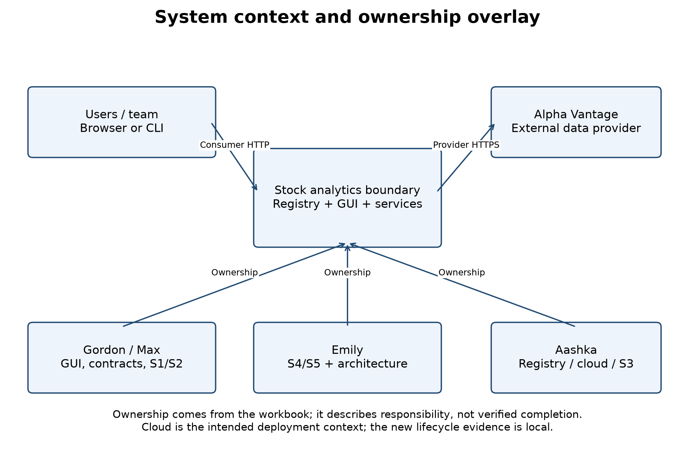
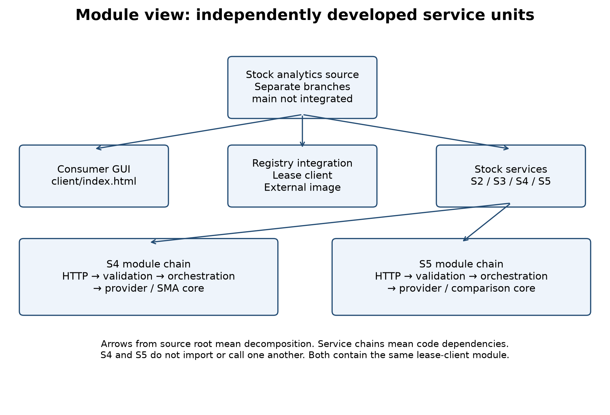
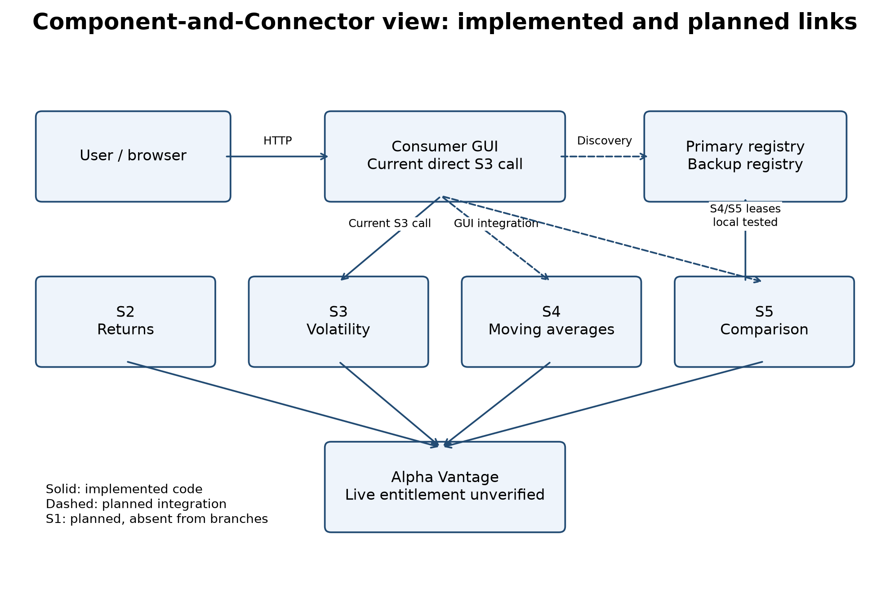
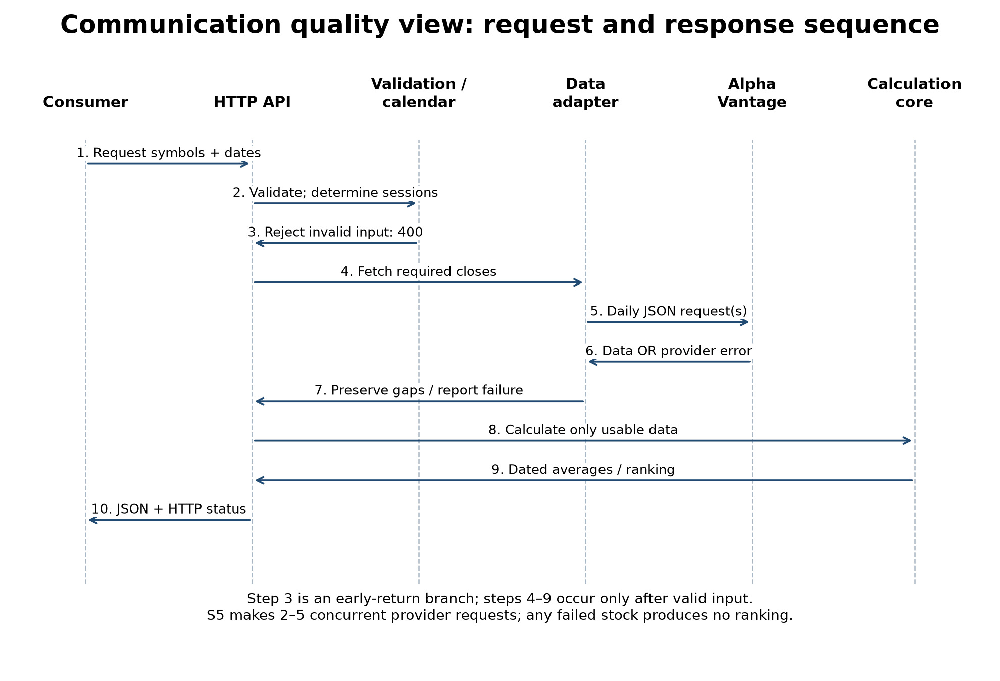
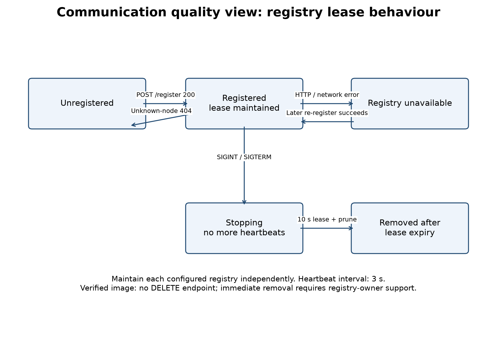

# Document roadmap and evidence boundary

This package supplies the Module view (6.18), Component-and-Connector view (6.19),
and Emily's Communication quality view (part of 6.20). It also provides a system
overview and an ownership overlay for the team's PR2 binder. Gordon's other two
quality views must be supplied separately. This is a PR2 architecture snapshot,
not a claim of a completed final system.

Each view follows the assignment's five-part structure: primary presentation,
element catalogue, context diagram, variability guide, and architecture background.
The background includes rationale, assumptions, limitations and verification.
The structure is consistent with SEI's view-documentation guidance [2].

## Current and intended system

The project offers stock price history (S1), returns (S2), volatility (S3), moving
averages (S4), and comparison (S5). Services are independently executable Python
HTTP processes. A consumer GUI should discover service URLs through a registry.
Primary and backup registries mitigate the discovery single point of failure.
Alpha Vantage provides unadjusted daily closing prices. No service depends on
S1 to obtain its own data; failure or removal of S1 must not break the others.

## Evidence inventory

| Item | Verified state on November 11 |
| --- | --- |
| Main branch | Initial README only; service integration and required PR approvals remain pending. |
| S1 | No implementation found in fetched branches. |
| S2 | Separate package and Dockerfile; 39 offline tests passed in the branch audit. Registration metadata exists; lifecycle is not connected. |
| S3 and GUI | Separate branch; GUI calls S3 directly and simulates other results. S3 failure/validation blockers remain. |
| S4 | Calculation, source integration, validation, HTTP API, new lease lifecycle; 56 offline tests pass. |
| S5 | Comparison, concurrent source lookups, validation, HTTP API, new lease lifecycle; 61 offline tests pass. |
| Registry contract | Read-only extraction from public aashkaaa/stock-registry image; POST /register, POST /heartbeat, GET /services. |
| Local lifecycle integration | Both S4/S5 registered against the extracted registry source. S4 removal occurred 11.41 s after graceful shutdown; S5 remained registered and returned health 200. |
| Live provider/cloud | User reports no Alpha Vantage key configured. One-year live retrieval, cloud deployment and GUI end-to-end verification are not claimed. |

The registry test used local HTTP processes, not a running Docker deployment.
Its evidence is in `evidence/registry-local-test.json`. Container application-layer
digest: `sha256:501627b42b87019f45d0c49260220a5ebbf4ec177170b3421f3548894695a716`.

# View 1 — Module decomposition and dependency view (6.18)

## 1. Primary presentation

The diagram decomposes the system into consumer, registry integration and service
units. The S4/S5 chains describe code dependencies inside each service. Root arrows
mean decomposition, not runtime HTTP traffic. Separate branches are source-control
locations; they are not substitutes for a combined, tested release.

## 2. Element catalogue

| Module/unit | Responsibility and interface | Source location |
| --- | --- | --- |
| Consumer | User input, discovery/navigation and result rendering. Current HTML is a prototype with simulated values. | S3 branch: client/index.html |
| Registry server | Registration records, heartbeat leases and discovery inventory; packaged externally. | aashkaaa/stock-registry image |
| S2 package | Input validation, price retrieval/calendar checks and daily-return calculation. | Microservice-2: services/s2-stock-returns |
| S3 service | Daily and annualized volatility; existing review identifies insufficient-data and fabricated-fallback problems. | S3 branch: s3_volatility.py |
| S4 HTTP adapter | GET/POST /moving-averages, /health, /service-info and JSON errors. | Microservice-4: s4_app.py |
| S4 application/core | Request orchestration and 20/50-session SMA arithmetic, including gaps and warm-up. | s4_service.py; s4_moving_averages.py |
| S4 validation/provider | Consumer input checks and Alpha Vantage daily-close parsing. | s4_validation.py; alpha_vantage.py |
| S5 HTTP adapter | GET/POST /comparison, /health, /service-info and JSON errors. | Microservice-5: s5_app.py |
| S5 application/core | Concurrent per-stock lookups; common endpoints; exact ranking before display rounding. | s5_service.py; s5_stock_comparison.py |
| S5 validation/provider | 2–5 distinct symbols, dates, calendars and upstream parsing. | s5_validation.py; s5_alpha_vantage.py |
| Lease lifecycle | Register/renew both registries, recover from unknown-node responses, cease renewals at shutdown. Same module is deployed independently with each service. | Both branches: registry_lifecycle.py |
| Graceful local runner | Own process signals and stop the lifecycle in a finally block. | s4_server.py; s5_server.py |

S4 and S5 have no imports from each other's service modules. Their calculation
cores accept supplied data and can be tested without HTTP. Provider adapters
isolate upstream response parsing. Framework error handling belongs to the HTTP
adapter, while arithmetic and date-window decisions belong to the core/application.

## 3. Context diagram

The system context figure above shows the users, external provider and team
ownership. Dependencies on Flask, requests and exchange-calendar libraries are
deployment requirements declared in each service's requirements file. Source
ownership is separate from deployment: a process must include its own required
modules even when the same developer owns multiple services.

## 4. Variability guide

Set environment variables rather than editing source: provider credentials,
compact/full history, registry URLs and published service base URL. The request's
exchange/calendar selection determines expected sessions. Substitute a fake client
in unit tests. Add a new service as an independent unit with a documented API and
registry metadata rather than adding a cross-service import dependency.

## 5. Architecture background

Separation of calculation, validation, provider access and lifecycle makes
numerical correctness and failure behavior testable in isolation. Local registry
failure does not block the stock API from starting; registration is retried in a
background thread. This supports ASR1's isolation objective. Service-local provider
code avoids a mandatory dependency on another service, at the cost of duplicated
adapter logic and repeated provider requests. Shared data infrastructure is a
future design decision, not an existing database. Branch integration and a single
agreed interface catalogue remain team work.

# View 2 — Component-and-Connector view (6.19)

## 1. Primary presentation

Boxes are runtime components or external systems. Solid links represent
implemented communication code; dashed links represent planned GUI integration.
Implemented provider calls have mocked/local test evidence, not authenticated
live-data verification. S1 is planned and absent from the branch snapshot.

## 2. Element and connector catalogue

| Component/connector | Protocol and responsibility | State |
| --- | --- | --- |
| Consumer to registry | HTTP GET /services; choose a published URL using the returned record. | Intended; current HTML does not execute discovery. |
| Consumer to stock API | HTTP GET/POST inputs, JSON result/error. S2 uses /api/v1/stock-returns, S3 /volatility, S4 /moving-averages, S5 /comparison. | Individual APIs exist; GUI integration incomplete. |
| Service to registry | POST /register with service_id, name, description, url. | S3 has an existing client; new S4/S5 client locally tested. |
| Service heartbeat | POST /heartbeat with service_id every 3 s. A 404 triggers re-registration. | New S4/S5 lifecycle tested. |
| Service to backup | Same registration/heartbeat contract; maintain a lease on each configured registry. | New client sends independent requests; no server-to-server replication is assumed. |
| Service to provider | HTTPS query using TIME_SERIES_DAILY, symbol, outputsize, datatype and API key. Read 4. close as unadjusted data. | S2–S5 adapters implemented; no entitled key configured. |
| Shutdown to registry removal | Cease heartbeats; registry expires an inactive lease after 10 s and prunes every 2 s. | Local removal/isolation demonstrated. No immediate delete API exists. |

Registry records are in-memory state; they are lost on restart. The client
re-registers a service that the registry no longer knows. Neither replication nor
durable registry state is claimed. The image currently discards descriptions,
although the client supplies them; its owner must retain/return the field to
complete the specified discovery record.

## 3. Context diagram

The context/ownership diagram defines the application boundary. Alpha Vantage
and the chosen cloud platform are external dependencies. Localhost example URLs
are valid only from the same machine; deployed records must use addresses
reachable by consumers. Browser access across origins requires a same-origin
proxy or an explicit CORS policy; S4/S5 do not currently add permissive CORS.

## 4. Variability guide

Configure SERVICE_PUBLIC_URL and REGISTRY_URLS per deployment. Do not publish
localhost to remote clients. The current service record contains one URL, so
replicas sharing one service ID require deployment coordination. Configure an
explicit REGISTRY_REMOVE_PATH only after the registry owner implements an agreed
DELETE contract. Leave it unset for the inspected image. Cloud ingress, hard
process deadlines, lease ownership across WSGI workers and secret management need
deployment-level configuration.

## 5. Architecture background

Discovery decouples a user's entry point from fixed service addresses. Independent
leases let one service stop without modifying the others. Maintaining both
registries prepares for consumer failover, but does not by itself implement the
GUI's failover routing. The prototype's button currently changes labels only.
The integration test supports local service isolation; it does not prove cloud
availability, uninterrupted discovery or instantaneous removal. When a process
dies before cleanup, lease expiry is the same fallback as graceful shutdown.

# View 3 — Communication quality view (Emily's part of 6.20)

## 1. Primary presentation and behavior

The primary scenario is a consumer supplying valid symbol(s) and dates. The API
validates strings, real ISO dates, order and calendars before any provider calls.
Invalid input returns 400 immediately. A valid request produces dated averages or
a ranked comparison. Provider failures follow an error branch, not the success
calculation path. The sequence labels identify these branches; they are not a
single unconditional execution trace.

The lifecycle state model is orthogonal to calculation. A service can answer
health and stock requests even when registration is unavailable. Each registry
has its own registration state. Graceful SIGINT/SIGTERM stops renewals through
the provided runner. Normal process exit uses atexit as an additional cleanup.

## 2. Message and element catalogue

| Interaction | Input/message | Output or failure |
| --- | --- | --- |
| S4 request | symbol, start_date, end_date; optional exchange | Ordered date, sma_20, sma_50; null/reason per incomplete window. |
| S5 request | 2–5 distinct symbols, start/end dates; optional exchange and per-symbol overrides | Common effective dates and descending percentage-change ranking; no partial ranking on any stock failure. |
| Validation | GET query or POST JSON; no mixed inputs; bounded body | 400 with code/message and field where available; 413 for oversized body; 415 for unsupported media. |
| Data lookup | Unadjusted source closes plus independent expected sessions | Missing sessions remain missing; weekends/holidays are not invented observations. |
| Provider control/error | HTTP status or Note/Information/Error Message | Sanitized error category, affected symbol and appropriate HTTP status; no raw provider/exception credential text. |
| Discovery | GET /services | Registry's available records; current image omits description. |
| Lease | Registration metadata; heartbeat service_id | 200 renews state; 404 heartbeat means re-register; network/HTTP error is retried on a later cycle. |

S4/S5 use 404 for unknown/unavailable data, 422 for insufficient data, 429 for
provider quota, 502 for upstream failures, 503 for configuration and 504 for
timeouts. S2 currently uses different names/statuses for some categories; a
cross-service error contract is not yet fully unified. Full API examples remain
in each branch's docs/s4-api.md or docs/s5-api.md.

## 3. Context diagram

The communicating parties are consumer, service API, provider and registry.
Consumer-facing stock APIs do not accept provider API keys; credentials are read
from the server environment. Registration contains discoverability metadata, not
stock observations or provider credentials. Error responses and logs omit raw
exception strings that may contain credential-bearing URLs.

## 4. Variability guide

Choose full history for arbitrary historical intervals and compact for covered
recent intervals. Full daily history requires premium entitlement [3]. Stock
symbols remain user-selected; no fixed company list is encoded. Select the correct
exchange calendar explicitly. For mixed exchanges, use S5's per-symbol overrides.
Changing a registry address changes configuration rather than service arithmetic.
Use the documented same-origin/proxy strategy when integrating browser calls.

## 5. Architecture background, scenarios and acceptance evidence

| Scenario | Required observable behavior | Evidence/limit |
| --- | --- | --- |
| Invalid date or duplicated S5 symbol | Return 400 before contacting provider. | S4/S5 HTTP tests pass. |
| Missing price in a 50-session SMA window | Return null/reason for that window while retaining any valid 20-session result. | S4 core/source/HTTP tests pass. |
| One S5 stock fails | Return a symbol-specific error and no ranking. | S5 source/HTTP tests pass. |
| Registry forgets a node | Heartbeat 404 leads to a fresh full registration record. | Lease-client unit test passes. |
| S4 shuts down while S5 runs | Stop S4 renewals; its lease expires; S5 remains available. | Real local HTTP test: S4 removed after 11.41 s, S5 health 200. |
| Provider unavailable | Structured timeout/error and success on a subsequent valid response. | Mocked recovery tests pass. Live provider recovery not measured. |

The communication design supports ASR1 isolation, ASR2 backup preparation and
ASR3 bounded upstream failure handling. S4 has a 10-second socket-inactivity
timeout, not a hard wall-clock deadline. S5 concurrently fetches stocks with a
12-second shared lookup wait budget, excluding calendar generation and final
serialization; running threads cannot forcibly abort a streaming response.
Therefore the QR2 15-second deployment guarantee remains unverified and needs
process/ingress enforcement and timed tests on the target cloud. No numerical
zero or artificial baseline substitutes for unavailable S4/S5 observations.

# Combined view and ownership interpretation

The context/ownership figure overlays decomposition responsibilities: Aashka owns
registry/cloud/S3 work; Gordon and Max own GUI/contracts/S1/S2 responsibilities;
Emily owns S4/S5 and the documentation listed here. This helps locate cross-team
interfaces needing agreement. Ownership arrows mean responsibility, not network
calls, and do not assert that every assigned item is complete. The workbook is
the authority for detailed assignments.

# Open decisions and handoff

- Registry owner: define immediate deregistration if required; retain descriptions
  in discovery; confirm cloud URLs and failover routing.
- Provider/account owner: configure an entitled key locally. The user has not
  selected an actual one-year data run; request-driven retrieval is implemented.
- Team: approve contracts, integrate reviewed branches, connect real GUI calls,
  assign the remaining two quality views and rehearse the presentation.
- Deployment owner: coordinate worker lease ownership, independent containers,
  process deadlines and lifecycle shutdown hooks.

# References

1. Course project description, 2026_v1_Project Description.pdf, PR2 section, pages 7–9. This is the assignment-specific authority for the documentation scope.
2. Software Engineering Institute, architecture documentation guidance, https://www.sei.cmu.edu/documents/850/2010_005_001_15281.pdf (view-template organization); checked November 11, 2026.
3. Alpha Vantage daily API documentation, https://www.alphavantage.co/documentation/#daily (raw closes and compact/full history); checked during source integration.
4. pandas_market_calendars usage, https://pandas-market-calendars.readthedocs.io/en/latest/usage.html.
5. GitHub source branches and local commits in the delivery manifest. External registry source was inspected read-only from its public image; no registry server changes were deployed.
